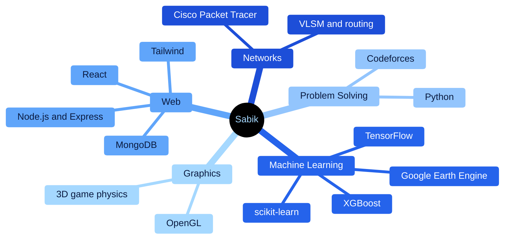
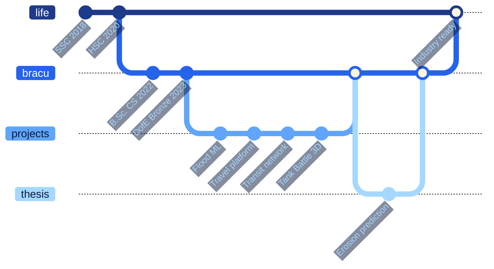

<div align="center">


<h3>Hi there  &nbsp;I build ML models, web apps and everything in between.</h3>

<a href="https://www.linkedin.com/in/sabikswanan"></a>
<a href="https://mail.google.com/mail/?view=cm&fs=1&to=sabikswanan@gmail.com"></a>
<a href="https://codeforces.com/profile/SabikSwanan"></a>


<a href="https://github.com/sabikswanan?tab=followers"></a>

<br/><br/>

<table>
  <tr>
    <td align="center" width="170"><h2>4</h2><sub><b>SHIPPED PROJECTS</b></sub></td>
    <td align="center" width="170"><h2>50K</h2><sub><b>ROWS IN MY ML BENCHMARK</b></sub></td>
    <td align="center" width="170"><h2>36</h2><sub><b>REST ENDPOINTS BUILT</b></sub></td>
    <td align="center" width="170"><h2>63+</h2><sub><b>CODEFORCES PROBLEMS</b></sub></td>
  </tr>
</table>

</div>


##  &nbsp;About Me

<table>
<tr>
<td width="55%" valign="top">

I'm a **Computer Science undergraduate at BRAC University** who loves turning messy data into clear
answers and ideas into software people can use.

 &nbsp;**Thesis** — a hybrid ML/DL framework with LLM integration that predicts **riverbank erosion** in Bangladesh from multi-temporal satellite data

 &nbsp;**Interests** — applied machine learning, remote sensing, data science

 &nbsp;**Problem solving** — 63+ algorithmic problems on Codeforces in Python

 &nbsp;**The Duke of Edinburgh's International Award** — Bronze Standard

 &nbsp;**Learning now** — deep learning for geospatial data

</td>
<td width="45%" valign="top" align="center">


</td>
</tr>
</table>


##  &nbsp;Featured Projects

<table>
<tr>
<td width="50%" valign="top">

###  &nbsp;[Flood Probability Prediction](https://github.com/sabikswanan/Flood-Probability-Prediction-Using-ML)

Predicts flood probability for 50,000 regions from 20 climate, land-use and governance risk factors, benchmarking four regressors.

> **KNN wins with R² 0.778**

  

</td>
<td width="50%" valign="top">

###  &nbsp;[Travel and Tourism Platform](https://github.com/sabikswanan/Travel-and-Tourism-Website)

Full-stack MERN booking platform with Gemini AI itineraries, Leaflet maps, live currency rates, wallet refunds and admin dashboards.

> **36 REST endpoints · 3 user roles**

   

</td>
</tr>
<tr>
<td width="50%" valign="top">

###  &nbsp;[Tank Battle 3D](https://github.com/sabikswanan/Tank-Battle-)

Wave-based 3D tank defense game built from scratch — arcing shell physics, enemy AI, power-ups, minimap and two cameras.

> **~1,000 lines · zero game engine**

  

</td>
<td width="50%" valign="top">

###  &nbsp;[Smart Transit Network](https://github.com/sabikswanan/Smart-Transit-Network-System)

Six-site transit network with VLSM addressing, RIP plus static routing, floating static failover and DHCP, DNS, web and email services.

> **6 routers · 12 subnets · auto failover**

  

</td>
</tr>
</table>


##  &nbsp;Tech Stack

<div align="center">

**Languages · ML and Data**

<table>
<tr><td align="center" width="96"><br/><sub><b>Python</b></sub></td><td align="center" width="96"><br/><sub><b>C</b></sub></td><td align="center" width="96"><br/><sub><b>JavaScript</b></sub></td><td align="center" width="96"><br/><sub><b>SQL</b></sub></td><td align="center" width="96"><br/><sub><b>scikit-learn</b></sub></td><td align="center" width="96"><br/><sub><b>TensorFlow</b></sub></td><td align="center" width="96"><br/><sub><b>pandas</b></sub></td></tr>
<tr><td align="center" width="96"><br/><sub><b>NumPy</b></sub></td><td align="center" width="96"><br/><sub><b>Jupyter</b></sub></td><td align="center" width="96"><br/><sub><b>Earth Engine</b></sub></td><td align="center" width="96"><br/><sub><b>Colab</b></sub></td><td align="center" width="96"><br/><sub><b>Kaggle</b></sub></td><td align="center" width="96"><br/><sub><b>HTML5</b></sub></td><td align="center" width="96"><br/><sub><b>CSS</b></sub></td></tr>
</table>

**Web · Databases · Graphics · Tools**

<table>
<tr><td align="center" width="96"><br/><sub><b>React</b></sub></td><td align="center" width="96"><br/><sub><b>Node.js</b></sub></td><td align="center" width="96"><br/><sub><b>Express</b></sub></td><td align="center" width="96"><br/><sub><b>Tailwind</b></sub></td><td align="center" width="96"><br/><sub><b>Vite</b></sub></td><td align="center" width="96"><br/><sub><b>MongoDB</b></sub></td><td align="center" width="96"><br/><sub><b>PostgreSQL</b></sub></td></tr>
<tr><td align="center" width="96"><br/><sub><b>OpenGL</b></sub></td><td align="center" width="96"><br/><sub><b>Packet Tracer</b></sub></td><td align="center" width="96"><br/><sub><b>Gemini API</b></sub></td><td align="center" width="96"><br/><sub><b>Git</b></sub></td><td align="center" width="96"><br/><sub><b>GitHub</b></sub></td><td align="center" width="96"><br/><sub><b>Vercel</b></sub></td><td align="center" width="96"><br/><sub><b>Figma</b></sub></td></tr>
</table>

</div>

<details>
<summary><b> &nbsp;See how it all connects — skills map</b></summary>
<br/>



</details>


##  &nbsp;Certifications and Achievements

<table>
<tr>
<td width="50%" valign="top">

####  &nbsp;DataCamp — Statements of Accomplishment

| Course | |
|---|:---:|
| Reshaping Data with pandas | [View ↗](https://www.datacamp.com/completed/statement-of-accomplishment/course/a1edf62c3cfc8516b2f90c484e564b5e66dfa70d) |
| Cleaning Data in Python | [View ↗](https://www.datacamp.com/completed/statement-of-accomplishment/course/a0235567ac438700f6018a9ebec6d97b7483f406) |
| Introduction to Importing Data in Python | [View ↗](https://www.datacamp.com/completed/statement-of-accomplishment/course/e26b86b5041d54d5040f37a8aee5c8f69c83a565) |
| Intermediate Importing Data in Python | [View ↗](https://www.datacamp.com/completed/statement-of-accomplishment/course/0da86f07f1497b49bc36044ecbab4b3d29e275be) |

</td>
<td width="50%" valign="top">

####  &nbsp;Achievements

| Achievement | |
|---|:---:|
| The Duke of Edinburgh's International Award — Bronze Standard | 2023 |
| Competitive programming — 63+ problems on [Codeforces](https://codeforces.com/profile/SabikSwanan) | Python |
| Volunteer — International Coastal Cleanup, Cox's Bazar | 2023 |
| Assistant Director — BRAC University Business Club (BIZ BEE) | Leadership |

</td>
</tr>
</table>


##  &nbsp;Pick Your Path

<details>
<summary><b> &nbsp;Recruiter — the 30-second version</b></summary>
<br/>

| | |
|---|---|
| **Who** | Computer Science undergraduate at **BRAC University**, Dhaka |
| **Strongest in** | Python · machine learning (scikit-learn, TensorFlow) · data analysis · MERN web development |
| **Proof** | 4 documented projects — ML benchmarking, a full-stack booking platform, a 3D OpenGL game and a multi-site network design |
| **Research** | Undergraduate thesis on riverbank erosion prediction with satellite data, ML/DL and an LLM reporting layer |
| **Extras** | 4 DataCamp data courses · 63+ Codeforces problems · The Duke of Edinburgh's International Award (Bronze) |
| **Looking for** | Internships and entry-level roles in ML, data or software engineering |
| **Contact** | [sabikswanan@gmail.com](https://mail.google.com/mail/?view=cm&fs=1&to=sabikswanan@gmail.com) · [LinkedIn](https://www.linkedin.com/in/sabikswanan) |

</details>

<details>
<summary><b> &nbsp;Developer — show me the tech</b></summary>
<br/>

```python
class Sabik:
    university = "BRAC University"
    degree     = "B.Sc. in Computer Science"
    location   = "Dhaka, Bangladesh"
    ml_data    = ["pandas", "scikit-learn", "TensorFlow", "SHAP", "Google Earth Engine"]
    web        = ["React 19", "Express 5", "MongoDB", "JWT", "Gemini API", "Leaflet"]
    graphics   = ["PyOpenGL", "GLUT", "projectile physics", "enemy AI"]
    networks   = ["VLSM", "RIP", "floating static routes", "DHCP", "DNS"]
    algorithms = ["Dijkstra", "BFS", "topological sort", "Kruskal + Union-Find"]
```

</details>

<details>
<summary><b> &nbsp;Student — let's collaborate</b></summary>
<br/>

Always happy to talk ML, remote sensing, competitive programming or course projects.
Reach out on [LinkedIn](https://www.linkedin.com/in/sabikswanan) or drop a ⭐ on a repo you found useful.

</details>


##  &nbsp;My Journey — as a git log




##  &nbsp;GitHub Analytics

<div align="center">


<sub>Contribution calendar · darker blue = more commits</sub>

</div>


##  &nbsp;Let's Connect

<div align="center">

<a href="https://www.linkedin.com/in/sabikswanan"></a>
<a href="https://mail.google.com/mail/?view=cm&fs=1&to=sabikswanan@gmail.com"></a>
<a href="https://github.com/sabikswanan?tab=repositories"></a>

<br/><br/>


</div>
